# V4 신규 149명 — 이미지 및 검증 현황

이 페이지는 **정사 등록된 신규 149명**의 초상 현황이다. **실제 파일 기반 인물별 이미지 확보 90명, 미확보 59명.** 초기 40명+Fandom 채택 41건(요피 1건은 기존 인물과 중복·우주선 장면과 실루엣 제외), 별도 GitHub 소스 이미지 7장 등 **총 102개 이미지 파일**을 보관 중이다. 파일 다운로드 성공은 전체 원작 공식성·외부 이미지의 저작물 출처 확인이나 브라우저 표시 성공을 자동 보장하지 않는다. 기존 239장은 보존했다.

## 나이트런 기사단

| 인물 / 티어 | 미리보기 | 확인 상태 · 자료 |
|---|---|---|
| 드라이 레온하르트 (S) |  | 원작 컷 · [출처](https://www.harum.io/products/knight-run-knight-fall-manhwa) · 미저장 |
| 프레이 마이어 (EX) |  | 위키 인물 대표 컷 · [출처](https://knightrun.fandom.com/wiki/Pray_Mayer) · GitHub 파일 보관
| 앤 마이어 (A+) | 미확보 | [네이버](https://search.naver.com/search.naver?where=image&query=%EB%82%98%EC%9D%B4%ED%8A%B8%EB%9F%B0%20Knight%20Run%20%EC%95%A4%20%EB%A7%88%EC%9D%B4%EC%96%B4) · [구글](https://www.google.com/search?udm=2&q=%EB%82%98%EC%9D%B4%ED%8A%B8%EB%9F%B0%20Knight%20Run%20%EC%95%A4%20%EB%A7%88%EC%9D%B4%EC%96%B4%20Anne%20Mayer%20%EC%9B%90%EC%9E%91%20%EC%BA%90%EB%A6%AD%ED%84%B0%20%EC%96%BC%EA%B5%B4%20%ED%94%84%EB%A1%9C%ED%95%84) |
| 시온 자일 (A+) |  | 위키 인물별 대표 컷 · [출처](https://knightrun.fandom.com/wiki/Sion_Zail) · GitHub 파일 보관
| 리아 자일 (A+) | 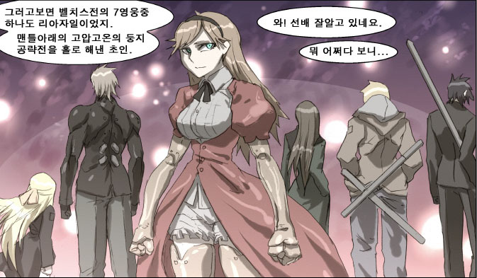 | 원작 컷 / 부분 단체 컷 · [출처](https://www.inven.co.kr/board/wot/3200/25033) · 미저장 |
| 마일로 레온하르트 (A+) |  | 원작 위키 캐릭터 페이지 대표 컷 · [출처](https://knightrun.fandom.com/wiki/Milo_Leonhard) · GitHub 파일 보관
| 가로우 라타 (A) | 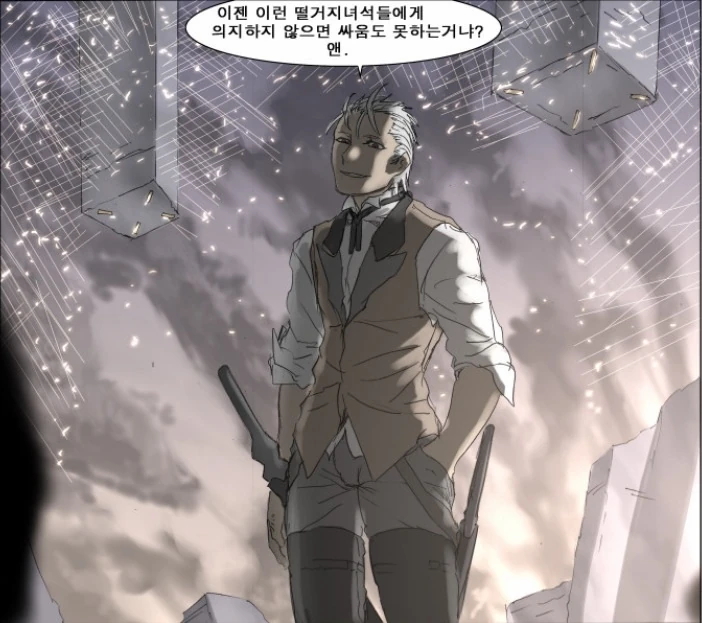 | 나이트런 인물별 위키 대표 컷 · [출처](https://knightrun.fandom.com/wiki/Garou_Rata) · GitHub 파일 보관 (저작권 별도 확인) |
| 라임 자일 (A) |  | 위키 인물별 대표 컷 · [출처](https://knightrun.fandom.com/wiki/Lime_Zail) · GitHub 파일 보관
| 다니엘 레온하르트 (A) |  | 원작 위키 캐릭터 페이지 대표 컷 · [출처](https://knightrun.fandom.com/wiki/Daniel_Leonhard) · GitHub 파일 보관
| 메이 자일 (A−) | 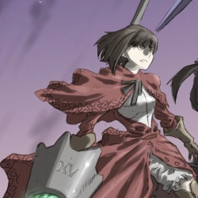 | 위키 인물별 대표 컷 · [출처](https://knightrun.fandom.com/wiki/May_Zail) · GitHub 파일 보관
| 레이 넬슨 (A−) |  | 나이트런 인물별 위키 대표 컷 · [출처](https://knightrun.fandom.com/wiki/Ray_Nelson) · GitHub 파일 보관 (저작권 별도 확인) |
| 제니 제이 (A−) | 미확보 | [네이버](https://search.naver.com/search.naver?where=image&query=%EB%82%98%EC%9D%B4%ED%8A%B8%EB%9F%B0%20Knight%20Run%20%EC%A0%9C%EB%8B%88%20%EC%A0%9C%EC%9D%B4) · [구글](https://www.google.com/search?udm=2&q=%EB%82%98%EC%9D%B4%ED%8A%B8%EB%9F%B0%20Knight%20Run%20%EC%A0%9C%EB%8B%88%20%EC%A0%9C%EC%9D%B4%20Jenny%20Jey%20%EC%9B%90%EC%9E%91%20%EC%BA%90%EB%A6%AD%ED%84%B0%20%EC%96%BC%EA%B5%B4%20%ED%94%84%EB%A1%9C%ED%95%84) |
| 단 (A−) |  | 나이트런 인물별 위키 대표 컷 · [출처](https://knightrun.fandom.com/wiki/Dan) · GitHub 파일 보관 (저작권 별도 확인) |
| 레오 (B+) | 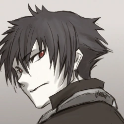 | 나이트런 인물별 위키 대표 컷 · [출처](https://knightrun.fandom.com/wiki/Leo) · GitHub 파일 보관 (저작권 별도 확인) |
| 레니 (B+) | 미확보 | [네이버](https://search.naver.com/search.naver?where=image&query=%EB%82%98%EC%9D%B4%ED%8A%B8%EB%9F%B0%20Knight%20Run%20%EB%A0%88%EB%8B%88) · [구글](https://www.google.com/search?udm=2&q=%EB%82%98%EC%9D%B4%ED%8A%B8%EB%9F%B0%20Knight%20Run%20%EB%A0%88%EB%8B%88%20Lenny%20%EC%9B%90%EC%9E%91%20%EC%BA%90%EB%A6%AD%ED%84%B0%20%EC%96%BC%EA%B5%B4%20%ED%94%84%EB%A1%9C%ED%95%84) |
| 클린트 자일 (B+) |  | 나이트런 인물별 위키 대표 컷 · [출처](https://knightrun.fandom.com/wiki/Clint_Zail) · GitHub 파일 보관 (저작권 별도 확인) |
| 질 맥켈런 (B) | 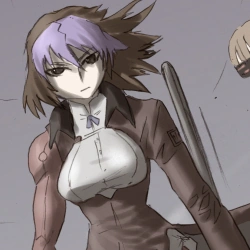 | 나이트런 인물별 위키 대표 컷 · [출처](https://knightrun.fandom.com/wiki/Jill_McKellen) · GitHub 파일 보관 (저작권 별도 확인) |
| 페이저 레온하르트 (B) | 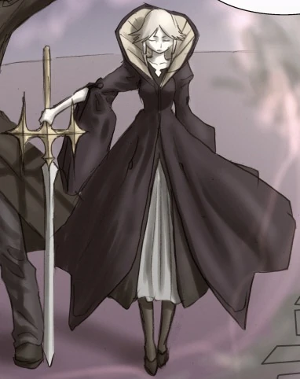 | 나이트런 인물별 위키 대표 컷 · [출처](https://knightrun.fandom.com/wiki/Feizer) · GitHub 파일 보관 (저작권 별도 확인) |
| 카마드 (B−) |  | 나이트런 인물별 위키 대표 컷 · [출처](https://knightrun.fandom.com/wiki/Kamad) · GitHub 파일 보관 (저작권 별도 확인) |
| 카말 (B−) | 미확보 | [네이버](https://search.naver.com/search.naver?where=image&query=%EB%82%98%EC%9D%B4%ED%8A%B8%EB%9F%B0%20Knight%20Run%20%EC%B9%B4%EB%A7%90) · [구글](https://www.google.com/search?udm=2&q=%EB%82%98%EC%9D%B4%ED%8A%B8%EB%9F%B0%20Knight%20Run%20%EC%B9%B4%EB%A7%90%20Kamal%20%EC%9B%90%EC%9E%91%20%EC%BA%90%EB%A6%AD%ED%84%B0%20%EC%96%BC%EA%B5%B4%20%ED%94%84%EB%A1%9C%ED%95%84) |

## 노블레스 유니온

| 인물 / 티어 | 미리보기 | 확인 상태 · 자료 |
|---|---|---|
| 마두크 (S) | 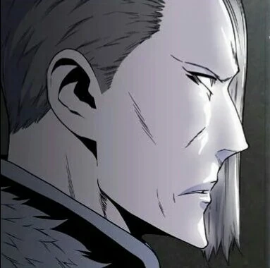 | 원작 위키 캐릭터 페이지 대표 컷 · [출처](https://noblesse.fandom.com/wiki/Maduke) · GitHub 파일 보관
| 록티스 크라베이 (A+) |  | 원작 위키 캐릭터 페이지 대표 컷 · [출처](https://noblesse.fandom.com/wiki/Roctis_Kravei) · GitHub 파일 보관
| 루나크 (A) | 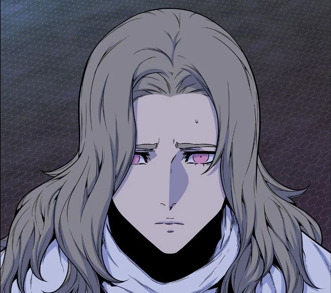 | 기존 사진 링크 · [출처](https://vignette.wikia.nocookie.net/noblesse/images/e/ea/Lunark484.jpg/revision/latest?cb=20171113165650) · 미저장 |
| 우로카이 아그바인 (A) |  | 팬아트 · [출처](https://www.zerochan.net/3920462) · 미저장 |
| 자르가 시리아나 (A) |  | 원작 위키 캐릭터 페이지 대표 컷 · [출처](https://noblesse.fandom.com/wiki/Zarga_Siriana) · GitHub 파일 보관
| 닥터 크롬벨 (A−) |  | 기존 사진 링크 · [출처](https://ami.animecharactersdatabase.com/uploads/chars/5092-1062649741.png) · 미저장 |
| 이그네스 크라베이 (A−) | 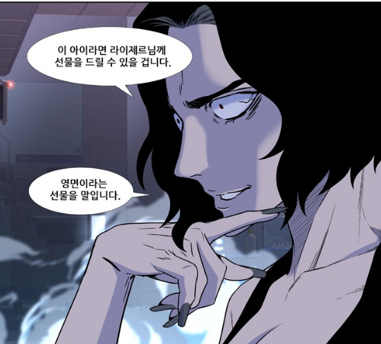 | 원작 컷 · [출처](https://www.newspim.com/news/view/20170131000050) · 미저장 |
| 로스테르 (B+) | 미확보 | [네이버](https://search.naver.com/search.naver?where=image&query=%EB%85%B8%EB%B8%94%EB%A0%88%EC%8A%A4%20Noblesse%20%EB%A1%9C%EC%8A%A4%ED%85%8C%EB%A5%B4) · [구글](https://www.google.com/search?udm=2&q=%EB%85%B8%EB%B8%94%EB%A0%88%EC%8A%A4%20Noblesse%20%EB%A1%9C%EC%8A%A4%ED%85%8C%EB%A5%B4%20Rostere%20%EC%9B%90%EC%9E%91%20%EC%BA%90%EB%A6%AD%ED%84%B0%20%EC%96%BC%EA%B5%B4%20%ED%94%84%EB%A1%9C%ED%95%84) |
| 무아르 (B+) | 미확보 | [네이버](https://search.naver.com/search.naver?where=image&query=%EB%85%B8%EB%B8%94%EB%A0%88%EC%8A%A4%20Noblesse%20%EB%AC%B4%EC%95%84%EB%A5%B4) · [구글](https://www.google.com/search?udm=2&q=%EB%85%B8%EB%B8%94%EB%A0%88%EC%8A%A4%20Noblesse%20%EB%AC%B4%EC%95%84%EB%A5%B4%20Muar%20%EC%9B%90%EC%9E%91%20%EC%BA%90%EB%A6%AD%ED%84%B0%20%EC%96%BC%EA%B5%B4%20%ED%94%84%EB%A1%9C%ED%95%84) |
| 하이든 (B) | 미확보 | [네이버](https://search.naver.com/search.naver?where=image&query=%EB%85%B8%EB%B8%94%EB%A0%88%EC%8A%A4%20Noblesse%20%ED%95%98%EC%9D%B4%EB%93%A0) · [구글](https://www.google.com/search?udm=2&q=%EB%85%B8%EB%B8%94%EB%A0%88%EC%8A%A4%20Noblesse%20%ED%95%98%EC%9D%B4%EB%93%A0%20Hayden%20%EC%9B%90%EC%9E%91%20%EC%BA%90%EB%A6%AD%ED%84%B0%20%EC%96%BC%EA%B5%B4%20%ED%94%84%EB%A1%9C%ED%95%84) |
| 지오 (B) | 미확보 | [네이버](https://search.naver.com/search.naver?where=image&query=%EB%85%B8%EB%B8%94%EB%A0%88%EC%8A%A4%20Noblesse%20%EC%A7%80%EC%98%A4) · [구글](https://www.google.com/search?udm=2&q=%EB%85%B8%EB%B8%94%EB%A0%88%EC%8A%A4%20Noblesse%20%EC%A7%80%EC%98%A4%20Gio%20%EC%9B%90%EC%9E%91%20%EC%BA%90%EB%A6%AD%ED%84%B0%20%EC%96%BC%EA%B5%B4%20%ED%94%84%EB%A1%9C%ED%95%84) |
| 테이즈 (B) | 미확보 | [네이버](https://search.naver.com/search.naver?where=image&query=%EB%85%B8%EB%B8%94%EB%A0%88%EC%8A%A4%20Noblesse%20%ED%85%8C%EC%9D%B4%EC%A6%88) · [구글](https://www.google.com/search?udm=2&q=%EB%85%B8%EB%B8%94%EB%A0%88%EC%8A%A4%20Noblesse%20%ED%85%8C%EC%9D%B4%EC%A6%88%20Taze%20%EC%9B%90%EC%9E%91%20%EC%BA%90%EB%A6%AD%ED%84%B0%20%EC%96%BC%EA%B5%B4%20%ED%94%84%EB%A1%9C%ED%95%84) |
| 로딘 (B−) | 미확보 | [네이버](https://search.naver.com/search.naver?where=image&query=%EB%85%B8%EB%B8%94%EB%A0%88%EC%8A%A4%20Noblesse%20%EB%A1%9C%EB%94%98) · [구글](https://www.google.com/search?udm=2&q=%EB%85%B8%EB%B8%94%EB%A0%88%EC%8A%A4%20Noblesse%20%EB%A1%9C%EB%94%98%20Rodin%20%EC%9B%90%EC%9E%91%20%EC%BA%90%EB%A6%AD%ED%84%B0%20%EC%96%BC%EA%B5%B4%20%ED%94%84%EB%A1%9C%ED%95%84) |
| 케드 (B−) | 미확보 | [네이버](https://search.naver.com/search.naver?where=image&query=%EB%85%B8%EB%B8%94%EB%A0%88%EC%8A%A4%20Noblesse%20%EC%BC%80%EB%93%9C) · [구글](https://www.google.com/search?udm=2&q=%EB%85%B8%EB%B8%94%EB%A0%88%EC%8A%A4%20Noblesse%20%EC%BC%80%EB%93%9C%20Ked%20%EC%9B%90%EC%9E%91%20%EC%BA%90%EB%A6%AD%ED%84%B0%20%EC%96%BC%EA%B5%B4%20%ED%94%84%EB%A1%9C%ED%95%84) |
| 루타이 (C+) | 미확보 | [네이버](https://search.naver.com/search.naver?where=image&query=%EB%85%B8%EB%B8%94%EB%A0%88%EC%8A%A4%20Noblesse%20%EB%A3%A8%ED%83%80%EC%9D%B4) · [구글](https://www.google.com/search?udm=2&q=%EB%85%B8%EB%B8%94%EB%A0%88%EC%8A%A4%20Noblesse%20%EB%A3%A8%ED%83%80%EC%9D%B4%20Rutai%20%EC%9B%90%EC%9E%91%20%EC%BA%90%EB%A6%AD%ED%84%B0%20%EC%96%BC%EA%B5%B4%20%ED%94%84%EB%A1%9C%ED%95%84) |
| 유이지 (C+) | 미확보 | [네이버](https://search.naver.com/search.naver?where=image&query=%EB%85%B8%EB%B8%94%EB%A0%88%EC%8A%A4%20Noblesse%20%EC%9C%A0%EC%9D%B4%EC%A7%80) · [구글](https://www.google.com/search?udm=2&q=%EB%85%B8%EB%B8%94%EB%A0%88%EC%8A%A4%20Noblesse%20%EC%9C%A0%EC%9D%B4%EC%A7%80%20Yuizi%20%EC%9B%90%EC%9E%91%20%EC%BA%90%EB%A6%AD%ED%84%B0%20%EC%96%BC%EA%B5%B4%20%ED%94%84%EB%A1%9C%ED%95%84) |
| 닥터 아리스 (C+) | 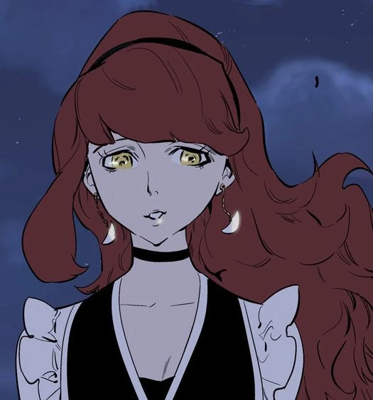 | 원작 위키 캐릭터 페이지 대표 컷 · [출처](https://noblesse.fandom.com/wiki/Dr._Aris) · GitHub 파일 보관
| 유리 (C+) | 미확보 | [네이버](https://search.naver.com/search.naver?where=image&query=%EB%85%B8%EB%B8%94%EB%A0%88%EC%8A%A4%20Noblesse%20%EC%9C%A0%EB%A6%AC) · [구글](https://www.google.com/search?udm=2&q=%EB%85%B8%EB%B8%94%EB%A0%88%EC%8A%A4%20Noblesse%20%EC%9C%A0%EB%A6%AC%20Yuri%20%EC%9B%90%EC%9E%91%20%EC%BA%90%EB%A6%AD%ED%84%B0%20%EC%96%BC%EA%B5%B4%20%ED%94%84%EB%A1%9C%ED%95%84) |
| 보네르 (C) | 미확보 | [네이버](https://search.naver.com/search.naver?where=image&query=%EB%85%B8%EB%B8%94%EB%A0%88%EC%8A%A4%20Noblesse%20%EB%B3%B4%EB%84%A4%EB%A5%B4) · [구글](https://www.google.com/search?udm=2&q=%EB%85%B8%EB%B8%94%EB%A0%88%EC%8A%A4%20Noblesse%20%EB%B3%B4%EB%84%A4%EB%A5%B4%20Boner%20%EC%9B%90%EC%9E%91%20%EC%BA%90%EB%A6%AD%ED%84%B0%20%EC%96%BC%EA%B5%B4%20%ED%94%84%EB%A1%9C%ED%95%84) |
| 제이크 (C) | 미확보 | [네이버](https://search.naver.com/search.naver?where=image&query=%EB%85%B8%EB%B8%94%EB%A0%88%EC%8A%A4%20Noblesse%20%EC%A0%9C%EC%9D%B4%ED%81%AC) · [구글](https://www.google.com/search?udm=2&q=%EB%85%B8%EB%B8%94%EB%A0%88%EC%8A%A4%20Noblesse%20%EC%A0%9C%EC%9D%B4%ED%81%AC%20Jake%20%EC%9B%90%EC%9E%91%20%EC%BA%90%EB%A6%AD%ED%84%B0%20%EC%96%BC%EA%B5%B4%20%ED%94%84%EB%A1%9C%ED%95%84) |
| 마리 (C) | 미확보 | [네이버](https://search.naver.com/search.naver?where=image&query=%EB%85%B8%EB%B8%94%EB%A0%88%EC%8A%A4%20Noblesse%20%EB%A7%88%EB%A6%AC) · [구글](https://www.google.com/search?udm=2&q=%EB%85%B8%EB%B8%94%EB%A0%88%EC%8A%A4%20Noblesse%20%EB%A7%88%EB%A6%AC%20Marie%20%EC%9B%90%EC%9E%91%20%EC%BA%90%EB%A6%AD%ED%84%B0%20%EC%96%BC%EA%B5%B4%20%ED%94%84%EB%A1%9C%ED%95%84) |
| 마크 (C−) | 미확보 | [네이버](https://search.naver.com/search.naver?where=image&query=%EB%85%B8%EB%B8%94%EB%A0%88%EC%8A%A4%20Noblesse%20%EB%A7%88%ED%81%AC) · [구글](https://www.google.com/search?udm=2&q=%EB%85%B8%EB%B8%94%EB%A0%88%EC%8A%A4%20Noblesse%20%EB%A7%88%ED%81%AC%20Mark%20%EC%9B%90%EC%9E%91%20%EC%BA%90%EB%A6%AD%ED%84%B0%20%EC%96%BC%EA%B5%B4%20%ED%94%84%EB%A1%9C%ED%95%84) |
| 칼빈 (C−) | 미확보 | [네이버](https://search.naver.com/search.naver?where=image&query=%EB%85%B8%EB%B8%94%EB%A0%88%EC%8A%A4%20Noblesse%20%EC%B9%BC%EB%B9%88) · [구글](https://www.google.com/search?udm=2&q=%EB%85%B8%EB%B8%94%EB%A0%88%EC%8A%A4%20Noblesse%20%EC%B9%BC%EB%B9%88%20Calvin%20%EC%9B%90%EC%9E%91%20%EC%BA%90%EB%A6%AD%ED%84%B0%20%EC%96%BC%EA%B5%B4%20%ED%94%84%EB%A1%9C%ED%95%84) |
| 크랜스 (C+) |  | 기존 사진 링크 · [출처](https://static.zerochan.net/Kranz.%28Noblesse%29.full.3080778.png) · 미저장 |
| 샤크 (C) | 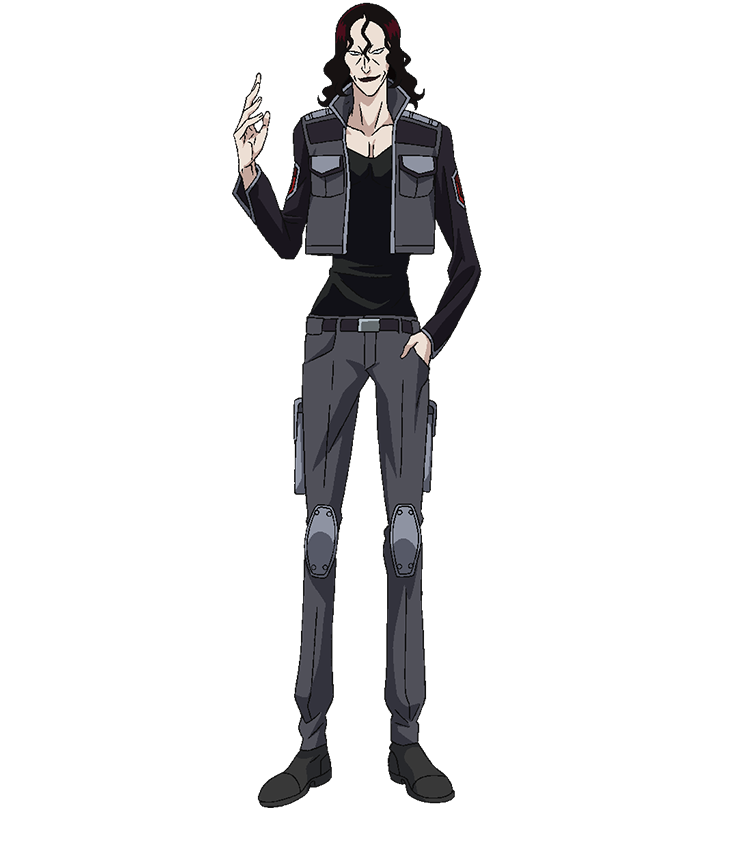 | 기존 사진 링크 · [출처](https://static.zerochan.net/Shark.%28Noblesse%29.full.3080781.png) · 미저장 |
| 해머 (C−) | 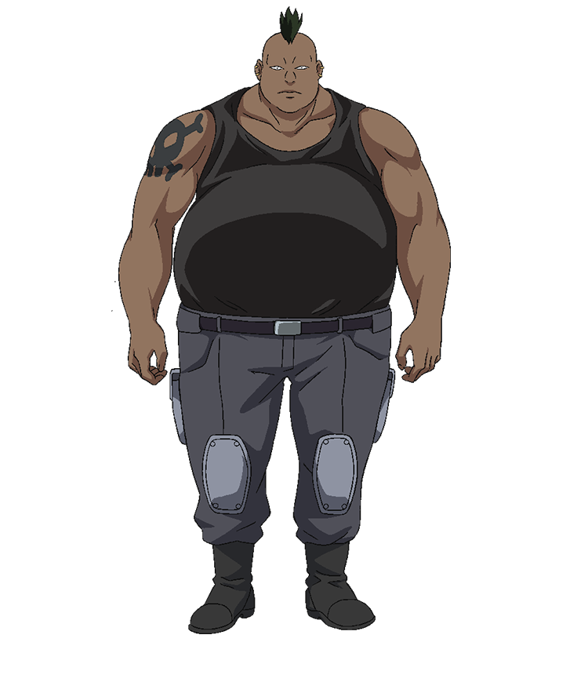 | 기존 사진 링크 · [출처](https://static.zerochan.net/Hammer.%28Noblesse%29.full.3080782.png) · 미저장 |

## 히어로 킬러 클랜

| 인물 / 티어 | 미리보기 | 확인 상태 · 자료 |
|---|---|---|
| 클랜 마스터 (S) | 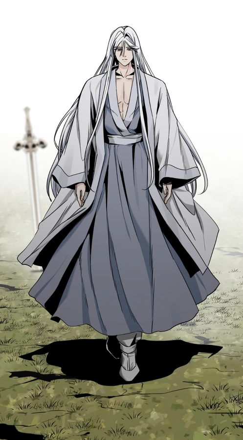 | 원작 위키 캐릭터 페이지 대표 컷 · [출처](https://herokiller.fandom.com/wiki/Master_of_the_Clan) · GitHub 파일 보관
| 비숍 (S) |  | 기존 사진 링크 · [출처](https://i.pinimg.com/736x/96/ff/68/96ff685994e81e367d04ca38abacba80.jpg) · 미저장 |
| 세인트 라이트 (A) | 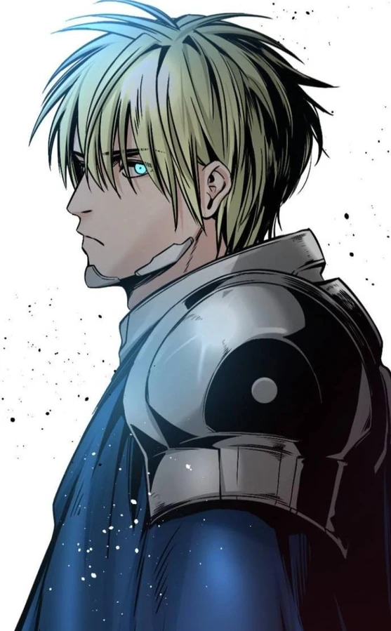 | 원작 위키 캐릭터 페이지 대표 컷 · [출처](https://herokiller.fandom.com/wiki/Saint_Light) · GitHub 파일 보관
| 마제스티 (A−) | 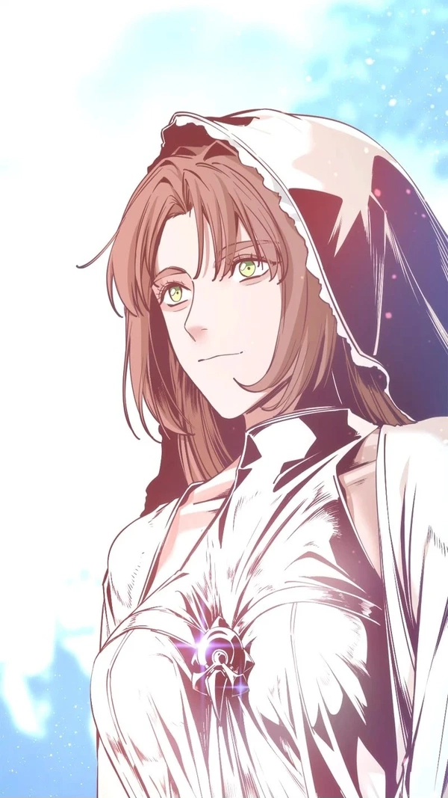 | 기존 사진 링크 · [출처](https://thicc-uwu.mywaifulist.moe/waifus/majesty/doX4Ta5nHyXS5OVNgTSho59CEDO03lp8FlUgkqsa.png?width=600) · 미저장 |
| 제나로 (A−) | 미확보 | [네이버](https://search.naver.com/search.naver?where=image&query=%ED%9E%88%EC%96%B4%EB%A1%9C%20%ED%82%AC%EB%9F%AC%20Hero%20Killer%20%EC%A0%9C%EB%82%98%EB%A1%9C) · [구글](https://www.google.com/search?udm=2&q=%ED%9E%88%EC%96%B4%EB%A1%9C%20%ED%82%AC%EB%9F%AC%20Hero%20Killer%20%EC%A0%9C%EB%82%98%EB%A1%9C%20Genaro%20%EC%9B%90%EC%9E%91%20%EC%BA%90%EB%A6%AD%ED%84%B0%20%EC%96%BC%EA%B5%B4%20%ED%94%84%EB%A1%9C%ED%95%84) |
| 풀문 (B+) | 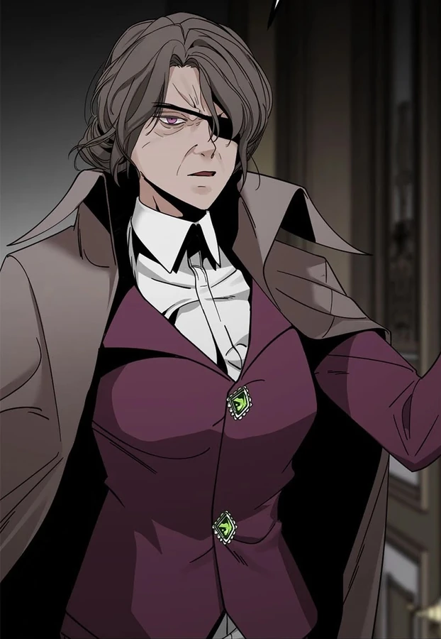 | 위키 인물 대표 컷 · [출처](https://herokiller.fandom.com/wiki/Fullmoon) · GitHub 파일 보관
| 헤비 스모커 (B+) | 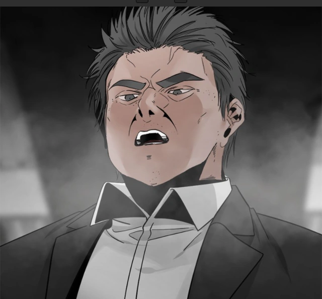 | 위키 인물 대표 컷 · [출처](https://herokiller.fandom.com/wiki/Heavy_Smoker) · GitHub 파일 보관
| 제로딘 (B+) |  | 위키 인물 대표 컷 · [출처](https://herokiller.fandom.com/wiki/Zerodin) · GitHub 파일 보관
| 바이스 (B) | 미확보 | [네이버](https://search.naver.com/search.naver?where=image&query=%ED%9E%88%EC%96%B4%EB%A1%9C%20%ED%82%AC%EB%9F%AC%20Hero%20Killer%20%EB%B0%94%EC%9D%B4%EC%8A%A4) · [구글](https://www.google.com/search?udm=2&q=%ED%9E%88%EC%96%B4%EB%A1%9C%20%ED%82%AC%EB%9F%AC%20Hero%20Killer%20%EB%B0%94%EC%9D%B4%EC%8A%A4%20Vice%20%EC%9B%90%EC%9E%91%20%EC%BA%90%EB%A6%AD%ED%84%B0%20%EC%96%BC%EA%B5%B4%20%ED%94%84%EB%A1%9C%ED%95%84) |
| 보이드 워커 (B) | 미확보 | [네이버](https://search.naver.com/search.naver?where=image&query=%ED%9E%88%EC%96%B4%EB%A1%9C%20%ED%82%AC%EB%9F%AC%20Hero%20Killer%20%EB%B3%B4%EC%9D%B4%EB%93%9C%20%EC%9B%8C%EC%BB%A4) · [구글](https://www.google.com/search?udm=2&q=%ED%9E%88%EC%96%B4%EB%A1%9C%20%ED%82%AC%EB%9F%AC%20Hero%20Killer%20%EB%B3%B4%EC%9D%B4%EB%93%9C%20%EC%9B%8C%EC%BB%A4%20Void%20Walker%20%EC%9B%90%EC%9E%91%20%EC%BA%90%EB%A6%AD%ED%84%B0%20%EC%96%BC%EA%B5%B4%20%ED%94%84%EB%A1%9C%ED%95%84) |
| 테러 나이트 (B) |  | 위키 인물 대표 컷 · [출처](https://herokiller.fandom.com/wiki/Terror_Knight) · GitHub 파일 보관
| 사이코 (B) | 미확보 | [네이버](https://search.naver.com/search.naver?where=image&query=%ED%9E%88%EC%96%B4%EB%A1%9C%20%ED%82%AC%EB%9F%AC%20Hero%20Killer%20%EC%82%AC%EC%9D%B4%EC%BD%94) · [구글](https://www.google.com/search?udm=2&q=%ED%9E%88%EC%96%B4%EB%A1%9C%20%ED%82%AC%EB%9F%AC%20Hero%20Killer%20%EC%82%AC%EC%9D%B4%EC%BD%94%20Psycho%20%EC%9B%90%EC%9E%91%20%EC%BA%90%EB%A6%AD%ED%84%B0%20%EC%96%BC%EA%B5%B4%20%ED%94%84%EB%A1%9C%ED%95%84) |
| 센슈 (B) | 미확보 | [네이버](https://search.naver.com/search.naver?where=image&query=%ED%9E%88%EC%96%B4%EB%A1%9C%20%ED%82%AC%EB%9F%AC%20Hero%20Killer%20%EC%84%BC%EC%8A%88) · [구글](https://www.google.com/search?udm=2&q=%ED%9E%88%EC%96%B4%EB%A1%9C%20%ED%82%AC%EB%9F%AC%20Hero%20Killer%20%EC%84%BC%EC%8A%88%20Senshu%20%EC%9B%90%EC%9E%91%20%EC%BA%90%EB%A6%AD%ED%84%B0%20%EC%96%BC%EA%B5%B4%20%ED%94%84%EB%A1%9C%ED%95%84) |
| 여섯 번째 손가락 (B) | 미확보 | [네이버](https://search.naver.com/search.naver?where=image&query=%ED%9E%88%EC%96%B4%EB%A1%9C%20%ED%82%AC%EB%9F%AC%20Hero%20Killer%20%EC%97%AC%EC%84%AF%20%EB%B2%88%EC%A7%B8%20%EC%86%90%EA%B0%80%EB%9D%BD) · [구글](https://www.google.com/search?udm=2&q=%ED%9E%88%EC%96%B4%EB%A1%9C%20%ED%82%AC%EB%9F%AC%20Hero%20Killer%20%EC%97%AC%EC%84%AF%20%EB%B2%88%EC%A7%B8%20%EC%86%90%EA%B0%80%EB%9D%BD%20Sixth%20Finger%20%EC%9B%90%EC%9E%91%20%EC%BA%90%EB%A6%AD%ED%84%B0%20%EC%96%BC%EA%B5%B4%20%ED%94%84%EB%A1%9C%ED%95%84) |
| 요원 23 (B−) | 미확보 | [네이버](https://search.naver.com/search.naver?where=image&query=%ED%9E%88%EC%96%B4%EB%A1%9C%20%ED%82%AC%EB%9F%AC%20Hero%20Killer%20%EC%9A%94%EC%9B%90%2023) · [구글](https://www.google.com/search?udm=2&q=%ED%9E%88%EC%96%B4%EB%A1%9C%20%ED%82%AC%EB%9F%AC%20Hero%20Killer%20%EC%9A%94%EC%9B%90%2023%20Agent%2023%20%EC%9B%90%EC%9E%91%20%EC%BA%90%EB%A6%AD%ED%84%B0%20%EC%96%BC%EA%B5%B4%20%ED%94%84%EB%A1%9C%ED%95%84) |
| 클레이모어 (B−) |  | 위키 인물 대표 컷 · [출처](https://herokiller.fandom.com/wiki/Claymore) · GitHub 파일 보관
| 캡틴 커틀러스 (C+) | 미확보 | [네이버](https://search.naver.com/search.naver?where=image&query=%ED%9E%88%EC%96%B4%EB%A1%9C%20%ED%82%AC%EB%9F%AC%20Hero%20Killer%20%EC%BA%A1%ED%8B%B4%20%EC%BB%A4%ED%8B%80%EB%9F%AC%EC%8A%A4) · [구글](https://www.google.com/search?udm=2&q=%ED%9E%88%EC%96%B4%EB%A1%9C%20%ED%82%AC%EB%9F%AC%20Hero%20Killer%20%EC%BA%A1%ED%8B%B4%20%EC%BB%A4%ED%8B%80%EB%9F%AC%EC%8A%A4%20Captain%20Cutlass%20%EC%9B%90%EC%9E%91%20%EC%BA%90%EB%A6%AD%ED%84%B0%20%EC%96%BC%EA%B5%B4%20%ED%94%84%EB%A1%9C%ED%95%84) |
| 샤프슈터 (C+) | 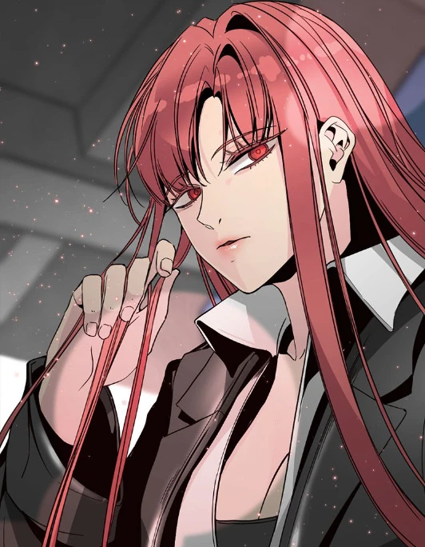 | 위키 인물별 대표 컷 · [출처](https://herokiller.fandom.com/wiki/Sharpshooter) · GitHub 파일 보관
| 골든 애로우 (C+) | 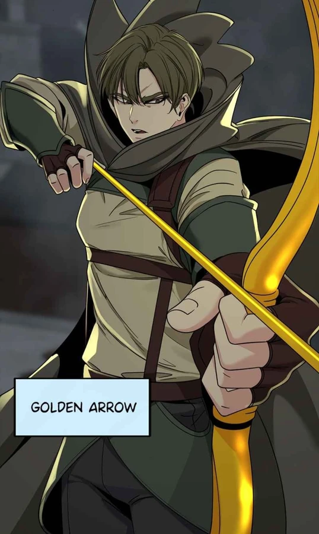 | 위키 인물별 대표 컷 · [출처](https://herokiller.fandom.com/wiki/Golden_Arrow) · GitHub 파일 보관
| 라제니아 싱클레어 (C+) | 미확보 | [네이버](https://search.naver.com/search.naver?where=image&query=%ED%9E%88%EC%96%B4%EB%A1%9C%20%ED%82%AC%EB%9F%AC%20Hero%20Killer%20%EB%9D%BC%EC%A0%9C%EB%8B%88%EC%95%84%20%EC%8B%B1%ED%81%B4%EB%A0%88%EC%96%B4) · [구글](https://www.google.com/search?udm=2&q=%ED%9E%88%EC%96%B4%EB%A1%9C%20%ED%82%AC%EB%9F%AC%20Hero%20Killer%20%EB%9D%BC%EC%A0%9C%EB%8B%88%EC%95%84%20%EC%8B%B1%ED%81%B4%EB%A0%88%EC%96%B4%20Lazenia%20Sinclair%20%EC%9B%90%EC%9E%91%20%EC%BA%90%EB%A6%AD%ED%84%B0%20%EC%96%BC%EA%B5%B4%20%ED%94%84%EB%A1%9C%ED%95%84) |
| 제이드 (C) | 미확보 | [네이버](https://search.naver.com/search.naver?where=image&query=%ED%9E%88%EC%96%B4%EB%A1%9C%20%ED%82%AC%EB%9F%AC%20Hero%20Killer%20%EC%A0%9C%EC%9D%B4%EB%93%9C) · [구글](https://www.google.com/search?udm=2&q=%ED%9E%88%EC%96%B4%EB%A1%9C%20%ED%82%AC%EB%9F%AC%20Hero%20Killer%20%EC%A0%9C%EC%9D%B4%EB%93%9C%20Jade%20%EC%9B%90%EC%9E%91%20%EC%BA%90%EB%A6%AD%ED%84%B0%20%EC%96%BC%EA%B5%B4%20%ED%94%84%EB%A1%9C%ED%95%84) |
| 바이퍼 (C) | 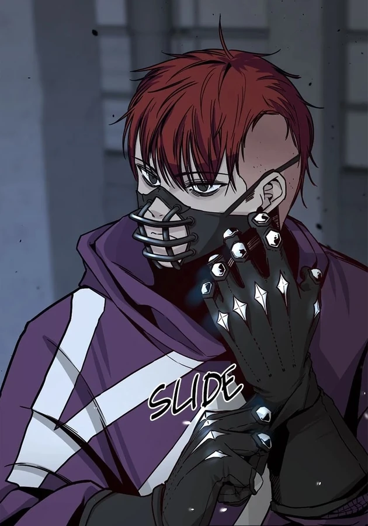 | 위키 인물별 대표 컷 · [출처](https://herokiller.fandom.com/wiki/Viper) · GitHub 파일 보관

## 일렉시드 프레임

| 인물 / 티어 | 미리보기 | 확인 상태 · 자료 |
|---|---|---|
| 안드레이 (A+) |  | 기존 사진 링크 · [출처](https://cdn.anime-planet.com/characters/primary/andrei-1.webp?t=1712291264) · 미저장 |
| 슈나우더 (A+) | 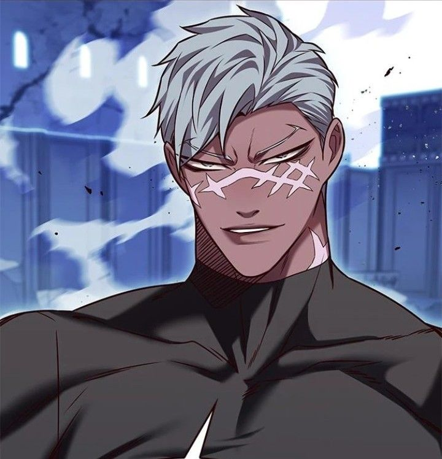 | 기존 사진 링크 · [출처](https://i.pinimg.com/originals/0a/f0/c0/0af0c0912b3859f9b0417f0729ba5b30.jpg) · 미저장 |
| 수프리 바스테르 (A+) |  | 원작 위키 캐릭터 페이지 대표 컷 · [출처](https://eleceed.fandom.com/wiki/Suffrey_Basseterre) · GitHub 파일 보관
| 어스퀘이크 (A−) | 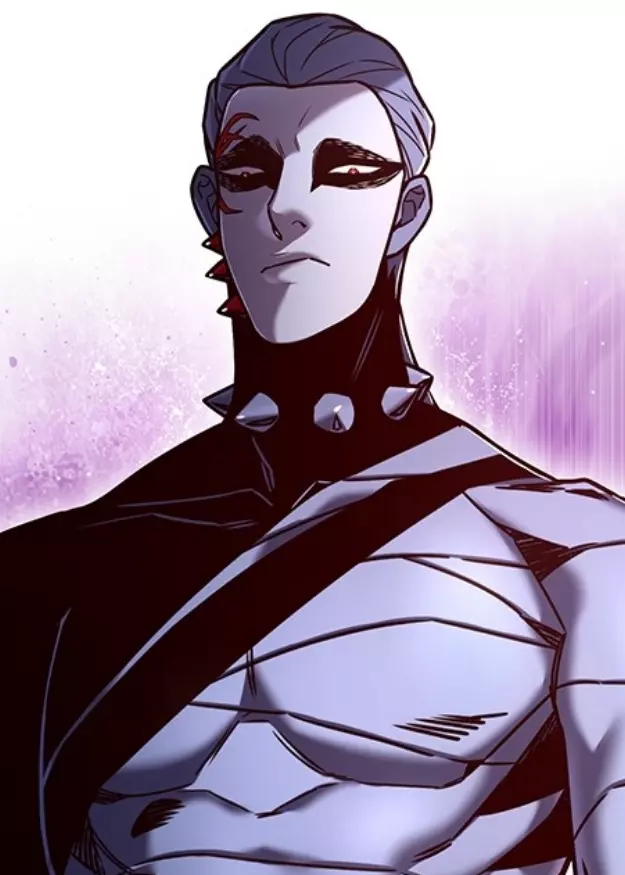 | 기존 사진 링크 · [출처](https://cdn.anime-planet.com/characters/primary/earthquake-eleceed-1.webp?t=1712286140) · 미저장 |
| 로이스트 (B+) |  | 기존 사진 링크 · [출처](https://cdn.anime-planet.com/characters/primary/roist-1.webp?t=1712203451) · 미저장 |
| 뮤스 (B+) |  | 기존 사진 링크 · [출처](https://cdn.anime-planet.com/characters/primary/muse-eleceed-1.webp?t=1712287988) · 미저장 |
| 이너스 (B) | 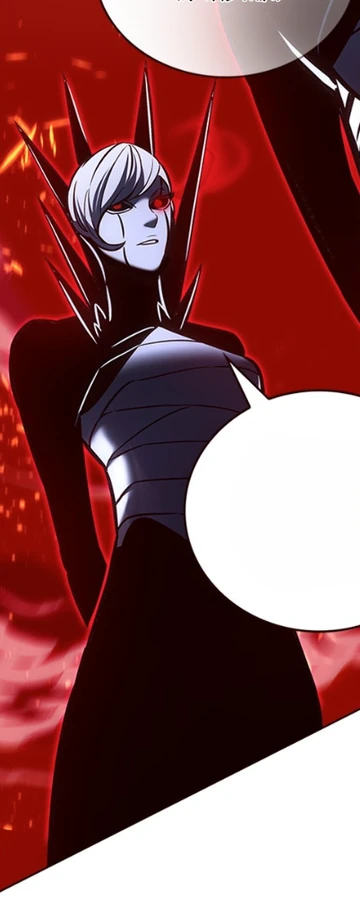 | 원작 위키 캐릭터 페이지 대표 컷 · [출처](https://eleceed.fandom.com/wiki/Inus) · GitHub 파일 보관
| 피오르드 (B−) |  | 원작 위키 캐릭터 페이지 대표 컷 · [출처](https://eleceed.fandom.com/wiki/Fiord) · GitHub 파일 보관
| 듀크 그레인 (C+) | 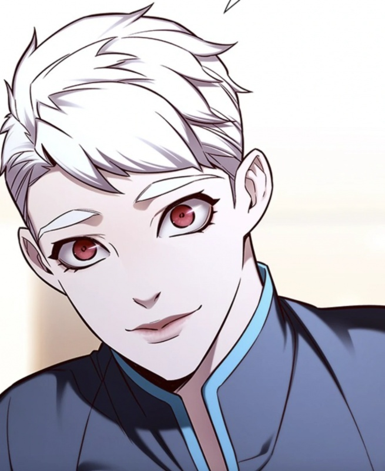 | 기존 사진 링크 · [출처](https://fanfics.me/images/fandoms_heroes/2268-1677982781-big.jpg) · 미저장 |

## 초인의 시대 뮈렐 진영

| 인물 / 티어 | 미리보기 | 확인 상태 · 자료 |
|---|---|---|
| 뮈렐 (S) | 미확보 | [네이버](https://search.naver.com/search.naver?where=image&query=%EC%B4%88%EC%9D%B8%EC%9D%98%20%EC%8B%9C%EB%8C%80%20The%20Superhuman%20Era%20%EB%AE%88%EB%A0%90) · [구글](https://www.google.com/search?udm=2&q=%EC%B4%88%EC%9D%B8%EC%9D%98%20%EC%8B%9C%EB%8C%80%20The%20Superhuman%20Era%20%EB%AE%88%EB%A0%90%20Mureul%20%EC%9B%90%EC%9E%91%20%EC%BA%90%EB%A6%AD%ED%84%B0%20%EC%96%BC%EA%B5%B4%20%ED%94%84%EB%A1%9C%ED%95%84) |
| 시드 베아킨 (A+) | 미확보 | [네이버](https://search.naver.com/search.naver?where=image&query=%EC%B4%88%EC%9D%B8%EC%9D%98%20%EC%8B%9C%EB%8C%80%20The%20Superhuman%20Era%20%EC%8B%9C%EB%93%9C%20%EB%B2%A0%EC%95%84%ED%82%A8) · [구글](https://www.google.com/search?udm=2&q=%EC%B4%88%EC%9D%B8%EC%9D%98%20%EC%8B%9C%EB%8C%80%20The%20Superhuman%20Era%20%EC%8B%9C%EB%93%9C%20%EB%B2%A0%EC%95%84%ED%82%A8%20Sid%20Beakin%20%EC%9B%90%EC%9E%91%20%EC%BA%90%EB%A6%AD%ED%84%B0%20%EC%96%BC%EA%B5%B4%20%ED%94%84%EB%A1%9C%ED%95%84) |
| 베히무스 (A+) | 미확보 | [네이버](https://search.naver.com/search.naver?where=image&query=%EC%B4%88%EC%9D%B8%EC%9D%98%20%EC%8B%9C%EB%8C%80%20The%20Superhuman%20Era%20%EB%B2%A0%ED%9E%88%EB%AC%B4%EC%8A%A4) · [구글](https://www.google.com/search?udm=2&q=%EC%B4%88%EC%9D%B8%EC%9D%98%20%EC%8B%9C%EB%8C%80%20The%20Superhuman%20Era%20%EB%B2%A0%ED%9E%88%EB%AC%B4%EC%8A%A4%20Behemoth%20%EC%9B%90%EC%9E%91%20%EC%BA%90%EB%A6%AD%ED%84%B0%20%EC%96%BC%EA%B5%B4%20%ED%94%84%EB%A1%9C%ED%95%84) |
| 판 (A+) |  | 원작 컷 · [출처](https://m.ruliweb.com/etcs/board/300781/read/57389301) · 미저장 |
| 데비아 카일리 (A) | 미확보 | [네이버](https://search.naver.com/search.naver?where=image&query=%EC%B4%88%EC%9D%B8%EC%9D%98%20%EC%8B%9C%EB%8C%80%20The%20Superhuman%20Era%20%EB%8D%B0%EB%B9%84%EC%95%84%20%EC%B9%B4%EC%9D%BC%EB%A6%AC) · [구글](https://www.google.com/search?udm=2&q=%EC%B4%88%EC%9D%B8%EC%9D%98%20%EC%8B%9C%EB%8C%80%20The%20Superhuman%20Era%20%EB%8D%B0%EB%B9%84%EC%95%84%20%EC%B9%B4%EC%9D%BC%EB%A6%AC%20Debia%20Kylie%20%EC%9B%90%EC%9E%91%20%EC%BA%90%EB%A6%AD%ED%84%B0%20%EC%96%BC%EA%B5%B4%20%ED%94%84%EB%A1%9C%ED%95%84) |
| 아포리오 아카반가 (A) | 미확보 | [네이버](https://search.naver.com/search.naver?where=image&query=%EC%B4%88%EC%9D%B8%EC%9D%98%20%EC%8B%9C%EB%8C%80%20The%20Superhuman%20Era%20%EC%95%84%ED%8F%AC%EB%A6%AC%EC%98%A4%20%EC%95%84%EC%B9%B4%EB%B0%98%EA%B0%80) · [구글](https://www.google.com/search?udm=2&q=%EC%B4%88%EC%9D%B8%EC%9D%98%20%EC%8B%9C%EB%8C%80%20The%20Superhuman%20Era%20%EC%95%84%ED%8F%AC%EB%A6%AC%EC%98%A4%20%EC%95%84%EC%B9%B4%EB%B0%98%EA%B0%80%20Aporio%20Akabanga%20%EC%9B%90%EC%9E%91%20%EC%BA%90%EB%A6%AD%ED%84%B0%20%EC%96%BC%EA%B5%B4%20%ED%94%84%EB%A1%9C%ED%95%84) |
| 그라브 (B+) | 미확보 | [네이버](https://search.naver.com/search.naver?where=image&query=%EC%B4%88%EC%9D%B8%EC%9D%98%20%EC%8B%9C%EB%8C%80%20The%20Superhuman%20Era%20%EA%B7%B8%EB%9D%BC%EB%B8%8C) · [구글](https://www.google.com/search?udm=2&q=%EC%B4%88%EC%9D%B8%EC%9D%98%20%EC%8B%9C%EB%8C%80%20The%20Superhuman%20Era%20%EA%B7%B8%EB%9D%BC%EB%B8%8C%20Grav%20%EC%9B%90%EC%9E%91%20%EC%BA%90%EB%A6%AD%ED%84%B0%20%EC%96%BC%EA%B5%B4%20%ED%94%84%EB%A1%9C%ED%95%84) |
| 갈타란 (B+) | 미확보 | [네이버](https://search.naver.com/search.naver?where=image&query=%EC%B4%88%EC%9D%B8%EC%9D%98%20%EC%8B%9C%EB%8C%80%20The%20Superhuman%20Era%20%EA%B0%88%ED%83%80%EB%9E%80) · [구글](https://www.google.com/search?udm=2&q=%EC%B4%88%EC%9D%B8%EC%9D%98%20%EC%8B%9C%EB%8C%80%20The%20Superhuman%20Era%20%EA%B0%88%ED%83%80%EB%9E%80%20Galtaran%20%EC%9B%90%EC%9E%91%20%EC%BA%90%EB%A6%AD%ED%84%B0%20%EC%96%BC%EA%B5%B4%20%ED%94%84%EB%A1%9C%ED%95%84) |
| 모스먼 (B) | 미확보 | [네이버](https://search.naver.com/search.naver?where=image&query=%EC%B4%88%EC%9D%B8%EC%9D%98%20%EC%8B%9C%EB%8C%80%20The%20Superhuman%20Era%20%EB%AA%A8%EC%8A%A4%EB%A8%BC) · [구글](https://www.google.com/search?udm=2&q=%EC%B4%88%EC%9D%B8%EC%9D%98%20%EC%8B%9C%EB%8C%80%20The%20Superhuman%20Era%20%EB%AA%A8%EC%8A%A4%EB%A8%BC%20Mossman%20%EC%9B%90%EC%9E%91%20%EC%BA%90%EB%A6%AD%ED%84%B0%20%EC%96%BC%EA%B5%B4%20%ED%94%84%EB%A1%9C%ED%95%84) |
| 바베루사 (B) | 미확보 | [네이버](https://search.naver.com/search.naver?where=image&query=%EC%B4%88%EC%9D%B8%EC%9D%98%20%EC%8B%9C%EB%8C%80%20The%20Superhuman%20Era%20%EB%B0%94%EB%B2%A0%EB%A3%A8%EC%82%AC) · [구글](https://www.google.com/search?udm=2&q=%EC%B4%88%EC%9D%B8%EC%9D%98%20%EC%8B%9C%EB%8C%80%20The%20Superhuman%20Era%20%EB%B0%94%EB%B2%A0%EB%A3%A8%EC%82%AC%20Babelusa%20%EC%9B%90%EC%9E%91%20%EC%BA%90%EB%A6%AD%ED%84%B0%20%EC%96%BC%EA%B5%B4%20%ED%94%84%EB%A1%9C%ED%95%84) |
| 카르멘 오피르 (B) | 미확보 | [네이버](https://search.naver.com/search.naver?where=image&query=%EC%B4%88%EC%9D%B8%EC%9D%98%20%EC%8B%9C%EB%8C%80%20The%20Superhuman%20Era%20%EC%B9%B4%EB%A5%B4%EB%A9%98%20%EC%98%A4%ED%94%BC%EB%A5%B4) · [구글](https://www.google.com/search?udm=2&q=%EC%B4%88%EC%9D%B8%EC%9D%98%20%EC%8B%9C%EB%8C%80%20The%20Superhuman%20Era%20%EC%B9%B4%EB%A5%B4%EB%A9%98%20%EC%98%A4%ED%94%BC%EB%A5%B4%20Carmen%20Ophir%20%EC%9B%90%EC%9E%91%20%EC%BA%90%EB%A6%AD%ED%84%B0%20%EC%96%BC%EA%B5%B4%20%ED%94%84%EB%A1%9C%ED%95%84) |
| 헤치 (B−) | 미확보 | [네이버](https://search.naver.com/search.naver?where=image&query=%EC%B4%88%EC%9D%B8%EC%9D%98%20%EC%8B%9C%EB%8C%80%20The%20Superhuman%20Era%20%ED%97%A4%EC%B9%98) · [구글](https://www.google.com/search?udm=2&q=%EC%B4%88%EC%9D%B8%EC%9D%98%20%EC%8B%9C%EB%8C%80%20The%20Superhuman%20Era%20%ED%97%A4%EC%B9%98%20Hechi%20%EC%9B%90%EC%9E%91%20%EC%BA%90%EB%A6%AD%ED%84%B0%20%EC%96%BC%EA%B5%B4%20%ED%94%84%EB%A1%9C%ED%95%84) |
| 라파 (B−) | 미확보 | [네이버](https://search.naver.com/search.naver?where=image&query=%EC%B4%88%EC%9D%B8%EC%9D%98%20%EC%8B%9C%EB%8C%80%20The%20Superhuman%20Era%20%EB%9D%BC%ED%8C%8C) · [구글](https://www.google.com/search?udm=2&q=%EC%B4%88%EC%9D%B8%EC%9D%98%20%EC%8B%9C%EB%8C%80%20The%20Superhuman%20Era%20%EB%9D%BC%ED%8C%8C%20Rafa%20%EC%9B%90%EC%9E%91%20%EC%BA%90%EB%A6%AD%ED%84%B0%20%EC%96%BC%EA%B5%B4%20%ED%94%84%EB%A1%9C%ED%95%84) |
| 시미온 (B−) | 미확보 | [네이버](https://search.naver.com/search.naver?where=image&query=%EC%B4%88%EC%9D%B8%EC%9D%98%20%EC%8B%9C%EB%8C%80%20The%20Superhuman%20Era%20%EC%8B%9C%EB%AF%B8%EC%98%A8) · [구글](https://www.google.com/search?udm=2&q=%EC%B4%88%EC%9D%B8%EC%9D%98%20%EC%8B%9C%EB%8C%80%20The%20Superhuman%20Era%20%EC%8B%9C%EB%AF%B8%EC%98%A8%20Simeon%20%EC%9B%90%EC%9E%91%20%EC%BA%90%EB%A6%AD%ED%84%B0%20%EC%96%BC%EA%B5%B4%20%ED%94%84%EB%A1%9C%ED%95%84) |
| 바빌론 배뉘셔 (C+) | 미확보 | [네이버](https://search.naver.com/search.naver?where=image&query=%EC%B4%88%EC%9D%B8%EC%9D%98%20%EC%8B%9C%EB%8C%80%20The%20Superhuman%20Era%20%EB%B0%94%EB%B9%8C%EB%A1%A0%20%EB%B0%B0%EB%89%98%EC%85%94) · [구글](https://www.google.com/search?udm=2&q=%EC%B4%88%EC%9D%B8%EC%9D%98%20%EC%8B%9C%EB%8C%80%20The%20Superhuman%20Era%20%EB%B0%94%EB%B9%8C%EB%A1%A0%20%EB%B0%B0%EB%89%98%EC%85%94%20Babylon%20%EC%9B%90%EC%9E%91%20%EC%BA%90%EB%A6%AD%ED%84%B0%20%EC%96%BC%EA%B5%B4%20%ED%94%84%EB%A1%9C%ED%95%84) |
| 지즈 하퍼 (C) | 미확보 | [네이버](https://search.naver.com/search.naver?where=image&query=%EC%B4%88%EC%9D%B8%EC%9D%98%20%EC%8B%9C%EB%8C%80%20The%20Superhuman%20Era%20%EC%A7%80%EC%A6%88%20%ED%95%98%ED%8D%BC) · [구글](https://www.google.com/search?udm=2&q=%EC%B4%88%EC%9D%B8%EC%9D%98%20%EC%8B%9C%EB%8C%80%20The%20Superhuman%20Era%20%EC%A7%80%EC%A6%88%20%ED%95%98%ED%8D%BC%20Jiz%20Harper%20%EC%9B%90%EC%9E%91%20%EC%BA%90%EB%A6%AD%ED%84%B0%20%EC%96%BC%EA%B5%B4%20%ED%94%84%EB%A1%9C%ED%95%84) |
| 토비온 (C) | 미확보 | [네이버](https://search.naver.com/search.naver?where=image&query=%EC%B4%88%EC%9D%B8%EC%9D%98%20%EC%8B%9C%EB%8C%80%20The%20Superhuman%20Era%20%ED%86%A0%EB%B9%84%EC%98%A8) · [구글](https://www.google.com/search?udm=2&q=%EC%B4%88%EC%9D%B8%EC%9D%98%20%EC%8B%9C%EB%8C%80%20The%20Superhuman%20Era%20%ED%86%A0%EB%B9%84%EC%98%A8%20Tobion%20%EC%9B%90%EC%9E%91%20%EC%BA%90%EB%A6%AD%ED%84%B0%20%EC%96%BC%EA%B5%B4%20%ED%94%84%EB%A1%9C%ED%95%84) |

## 전지적 독자 시점

| 인물 / 티어 | 미리보기 | 확인 상태 · 자료 |
|---|---|---|
| 김독자 (S) |  | 원작 컷 재게시 · [출처](https://www.pinterest.com/pin/620300548701636289/) · 미저장 |
| 유중혁 (S) |  | 원작풍 인물 초상 · [출처](https://mywaifulist.moe/waifu/yoo-joonghyuk-omniscient-reader-s-viewpoint) · 미저장 |
| 한수영 (A+) |  | 팬아트 참고 · [출처](https://www.pinterest.com/pin/glow-on-instagram-han-sooyoung-ily-hansooyoung-orv-omnisc--768426755180088817/) · 미저장 |
| 정희원 (A) | 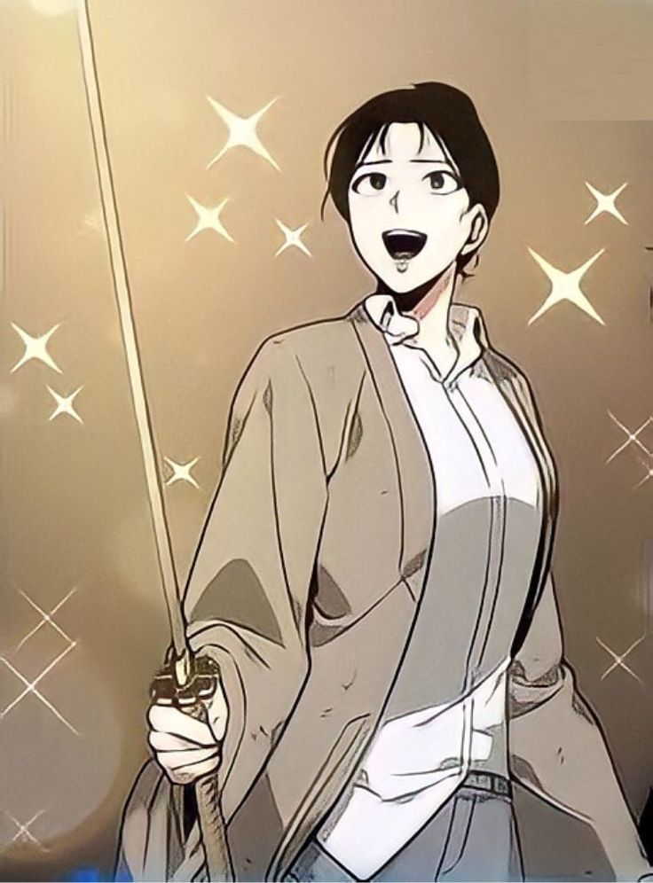 | 원작풍 컷 재게시 · [출처](https://nz.pinterest.com/pin/726205508696093689/) · 미저장 |
| 이현성 (A−) | 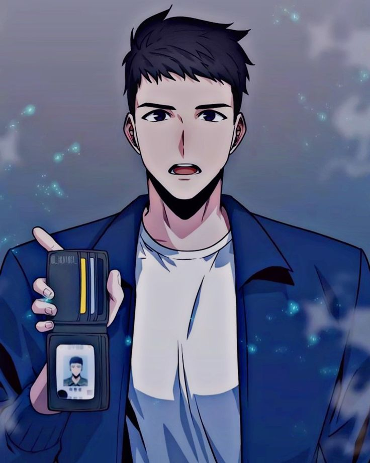 | 원작 컷 재게시 · [출처](https://www.pinterest.com/pin/lee-hyunsung-orv-in-2022--624381935850366883/) · 미저장 |
| 이지혜 (B+) |  | 위키 인물 대표 컷 · [출처](https://omniscient-readers-viewpoint.fandom.com/wiki/Lee_Jihye) · GitHub 파일 보관
| 장하영 (A−) |  | 위키 인물 대표 컷 · [출처](https://omniscient-readers-viewpoint.fandom.com/wiki/Jang_Hayoung) · GitHub 파일 보관
| 안나 크로프트 (B+) | 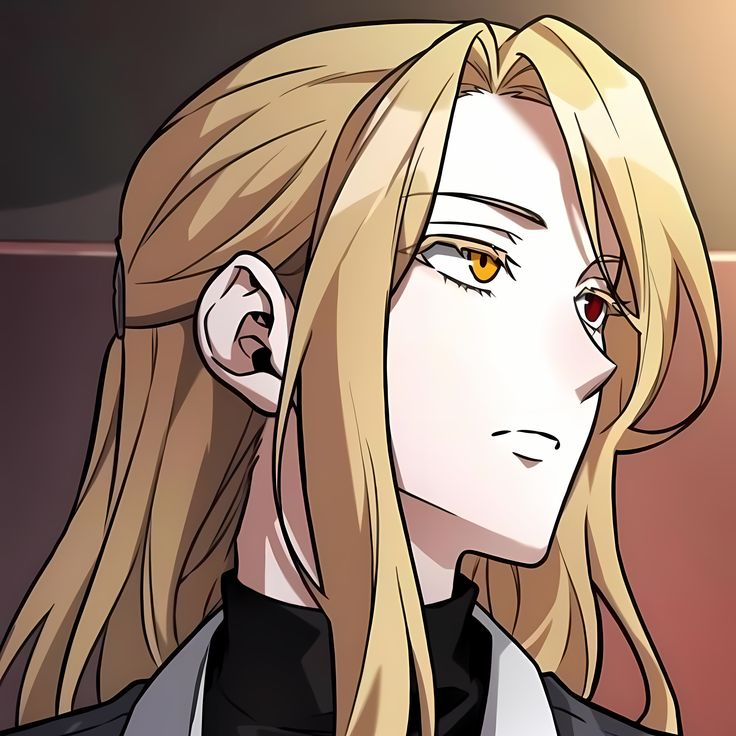 | 원작 컷 재게시 · [출처](https://www.pinterest.com/pin/anna-croft-in-2025--597782550576951929/) · 미저장 |
| 우리엘 (S) | 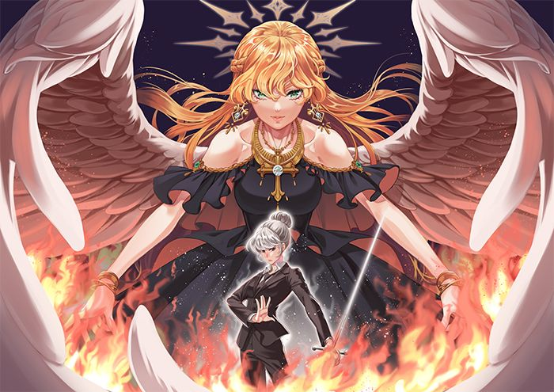 | 팬아트 / 복수 인물 · [출처](https://kr.pinterest.com/pin/orv--83809243057447147/) · 미저장 |

## 나 혼자만 레벨업

| 인물 / 티어 | 미리보기 | 확인 상태 · 자료 |
|---|---|---|
| 성진우 (EX) |  | 애니메이션/게임 인물컷 · [출처](https://gamdb.com/character/sung-jinwoo) · 미저장 |
| 차해인 (B) | 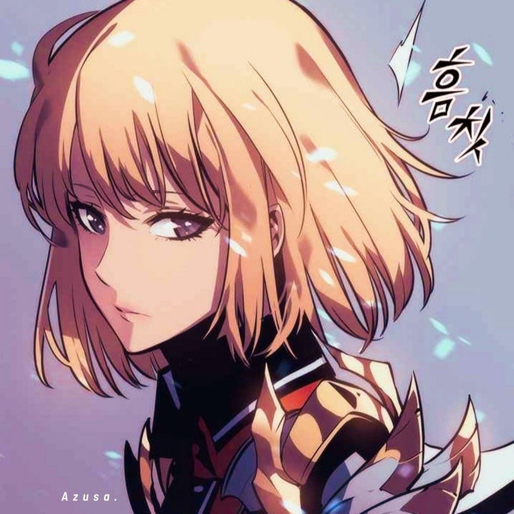 | 원작 컷 재게시 · [출처](https://www.pinterest.com/pin/cha-haein-solo-leveling-icon-in-2022--404761085271476538/) · 미저장 |
| 토마스 안드레 (A) |  | 게임 공식 디자인 사용 · [출처](https://slatracker.org/hunters/Thomas%20Andre) · 미저장 |
| 류즈캉 (A−) | 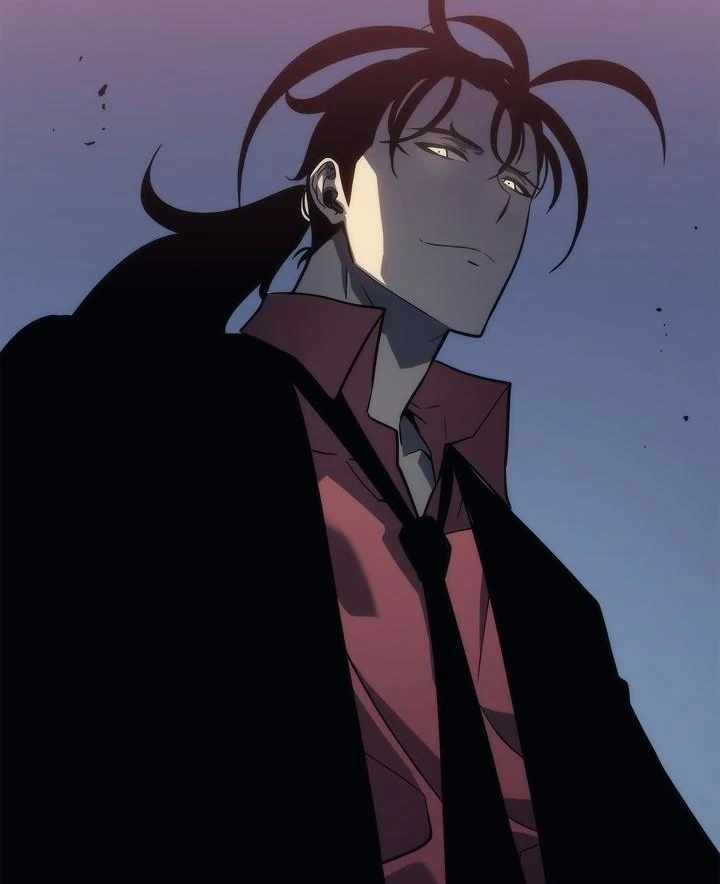 | 위키 인물 대표 컷 · [출처](https://solo-leveling.fandom.com/wiki/Liu_Zhigang) · GitHub 파일 보관
| 백윤호 (B) |  | 원작 컷 재게시 · [출처](https://www.pinterest.com/pin/character-design--616289530260663940/) · 미저장 |
| 황동수 (C+) | 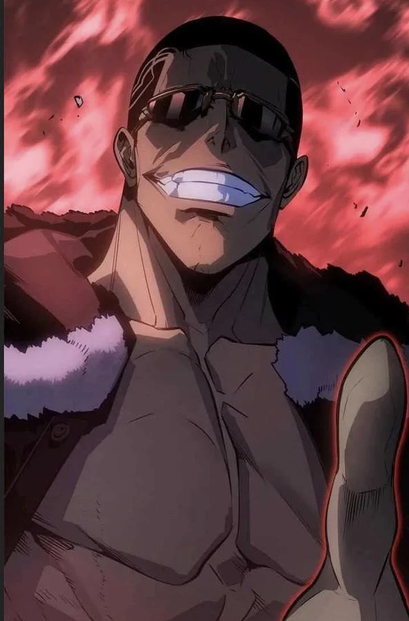 | 위키 인물 대표 컷 · [출처](https://solo-leveling.fandom.com/wiki/Hwang_Dongsoo) · GitHub 파일 보관
| 아스본 (S) | 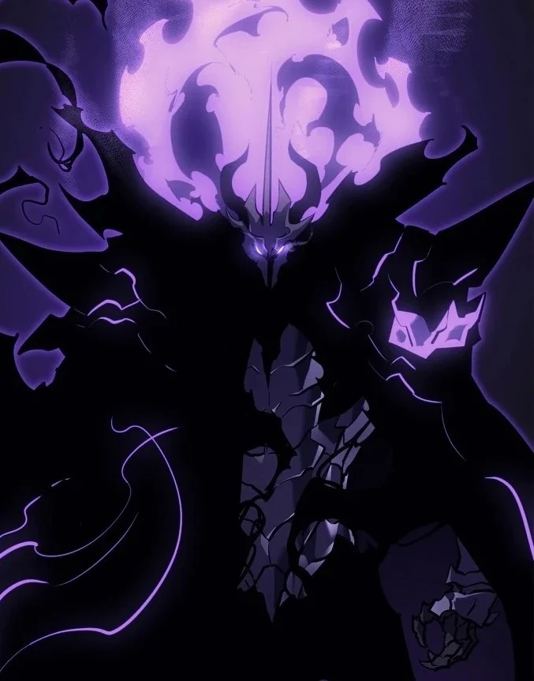 | 원작풍 컷 재게시 · [출처](https://solo-leveling.fr/pages/personnages-solo-leveling) · 미저장 |
| 안타레스 (S) |  | 원작 컷 재게시 · [출처](https://deltiasgaming.com/8-strongest-solo-leveling-characters-ranked/) · 미저장 |
| 레기아 (A+) |  | 위키 인물 대표 컷 · [출처](https://solo-leveling.fandom.com/wiki/Legia) · GitHub 파일 보관
| 바란 (A+) |  | 원작풍 컷 재게시 · [출처](https://kbeonline.id/2025/12/01/kenalan-lebih-dekat-10-fakta-white-flame-monarch-salah-satu-karakter-paling-inspiratif-di-solo-leveling/) · 미저장 |

## 호랑이형님

| 인물 / 티어 | 미리보기 | 확인 상태 · 자료 |
|---|---|---|
| 산군 (B+) |  | 원작 컷 · [출처](https://www.kmas.or.kr/webzine/review/2892) · 미저장 |
| 빠르 (B) | 미확보 | [네이버](https://search.naver.com/search.naver?where=image&query=%ED%98%B8%EB%9E%91%EC%9D%B4%ED%98%95%EB%8B%98%20%EB%B9%A0%EB%A5%B4%20%EC%96%BC%EA%B5%B4%20%EC%9B%90%EC%9E%91%20%EC%BA%90%EB%A6%AD%ED%84%B0) · [구글](https://www.google.com/search?udm=2&q=%ED%98%B8%EB%9E%91%EC%9D%B4%ED%98%95%EB%8B%98%20%EB%B9%A0%EB%A5%B4%20%EC%9B%B9%ED%88%B0%20%EC%9B%90%EC%9E%91%20%EC%96%BC%EA%B5%B4%20%EB%8B%A8%EB%8F%85%20%EC%BA%90%EB%A6%AD%ED%84%B0) |
| 추이 (A−) |  | 원작 컷 (외부 재게시, 권리 미확인) · [출처](https://www.wikitree.co.kr/articles/571955) · GitHub 파일 보관 |
| 흰눈썹 (B−) |  | 원작 컷 재게시 · [출처](https://dpbdpb.tistory.com/36) · 미저장 |
| 이령 (A+) | 미확보 | [네이버](https://search.naver.com/search.naver?where=image&query=%ED%98%B8%EB%9E%91%EC%9D%B4%ED%98%95%EB%8B%98%20%EC%9D%B4%EB%A0%B9%20%EC%96%BC%EA%B5%B4%20%EC%9B%90%EC%9E%91%20%EC%BA%90%EB%A6%AD%ED%84%B0) · [구글](https://www.google.com/search?udm=2&q=%ED%98%B8%EB%9E%91%EC%9D%B4%ED%98%95%EB%8B%98%20%EC%9D%B4%EB%A0%B9%20%EC%9B%B9%ED%88%B0%20%EC%9B%90%EC%9E%91%20%EC%96%BC%EA%B5%B4%20%EB%8B%A8%EB%8F%85%20%EC%BA%90%EB%A6%AD%ED%84%B0) |
| 압카 (S) |  | 원작 컷 (외부 재게시, 권리 미확인) · [출처](https://m.ruliweb.com/community/board/300143/read/70987990) · GitHub 파일 보관 |
| 아린 (S) | 미확보 | [기존 원작 컷 출처](https://dpbdpb.tistory.com/42) · 외부 이미지 주소 만료(파일 미보관) |
| 구망 (A+) | 미확보 | [네이버](https://search.naver.com/search.naver?where=image&query=%ED%98%B8%EB%9E%91%EC%9D%B4%ED%98%95%EB%8B%98%20%EA%B5%AC%EB%A7%9D%20%EC%96%BC%EA%B5%B4%20%EC%9B%90%EC%9E%91%20%EC%BA%90%EB%A6%AD%ED%84%B0) · [구글](https://www.google.com/search?udm=2&q=%ED%98%B8%EB%9E%91%EC%9D%B4%ED%98%95%EB%8B%98%20%EA%B5%AC%EB%A7%9D%20%EC%9B%B9%ED%88%B0%20%EC%9B%90%EC%9E%91%20%EC%96%BC%EA%B5%B4%20%EB%8B%A8%EB%8F%85%20%EC%BA%90%EB%A6%AD%ED%84%B0) |
| 무커 (B+) | 미확보 | [네이버](https://search.naver.com/search.naver?where=image&query=%ED%98%B8%EB%9E%91%EC%9D%B4%ED%98%95%EB%8B%98%20%EB%AC%B4%EC%BB%A4%20%EC%96%BC%EA%B5%B4%20%EC%9B%90%EC%9E%91%20%EC%BA%90%EB%A6%AD%ED%84%B0) · [구글](https://www.google.com/search?udm=2&q=%ED%98%B8%EB%9E%91%EC%9D%B4%ED%98%95%EB%8B%98%20%EB%AC%B4%EC%BB%A4%20%EC%9B%B9%ED%88%B0%20%EC%9B%90%EC%9E%91%20%EC%96%BC%EA%B5%B4%20%EB%8B%A8%EB%8F%85%20%EC%BA%90%EB%A6%AD%ED%84%B0) |
| 황요 (C) | 미확보 | [네이버](https://search.naver.com/search.naver?where=image&query=%ED%98%B8%EB%9E%91%EC%9D%B4%ED%98%95%EB%8B%98%20%ED%99%A9%EC%9A%94%20%EC%96%BC%EA%B5%B4%20%EC%9B%90%EC%9E%91%20%EC%BA%90%EB%A6%AD%ED%84%B0) · [구글](https://www.google.com/search?udm=2&q=%ED%98%B8%EB%9E%91%EC%9D%B4%ED%98%95%EB%8B%98%20%ED%99%A9%EC%9A%94%20%EC%9B%B9%ED%88%B0%20%EC%9B%90%EC%9E%91%20%EC%96%BC%EA%B5%B4%20%EB%8B%A8%EB%8F%85%20%EC%BA%90%EB%A6%AD%ED%84%B0) |

## 고수

| 인물 / 티어 | 미리보기 | 확인 상태 · 자료 |
|---|---|---|
| 강룡 (A−) |  | 원작 컷 · [출처](https://news.nate.com/view/20191217n32399) · 미저장 |
| 용비 (A−) | 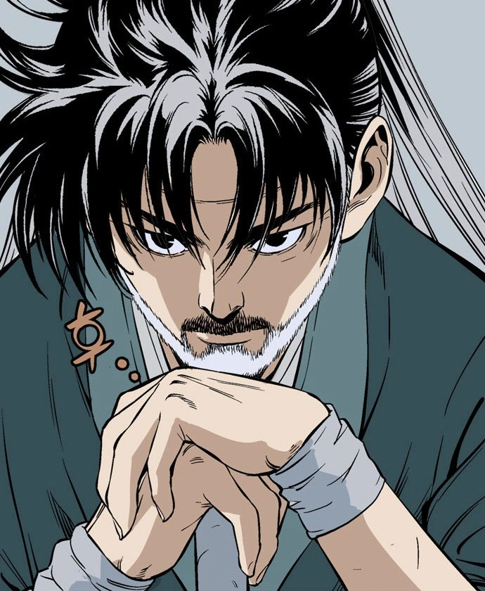 | 원작 컷 · [출처](https://gosuverse.fandom.com/wiki/Yongbi_%28character%29) · 미저장 |
| 구휘 (A−) | 미확보 | [네이버](https://search.naver.com/search.naver?where=image&query=%EA%B3%A0%EC%88%98%20%EA%B5%AC%ED%9C%98%20%EC%96%BC%EA%B5%B4%20%EC%9B%90%EC%9E%91%20%EC%BA%90%EB%A6%AD%ED%84%B0) · [구글](https://www.google.com/search?udm=2&q=%EA%B3%A0%EC%88%98%20%EA%B5%AC%ED%9C%98%20%EC%9B%B9%ED%88%B0%20%EC%9B%90%EC%9E%91%20%EC%96%BC%EA%B5%B4%20%EB%8B%A8%EB%8F%85%20%EC%BA%90%EB%A6%AD%ED%84%B0) |
| 진가령 (B) | 미확보 | [네이버](https://search.naver.com/search.naver?where=image&query=%EA%B3%A0%EC%88%98%20%EC%A7%84%EA%B0%80%EB%A0%B9%20%EC%96%BC%EA%B5%B4%20%EC%9B%90%EC%9E%91%20%EC%BA%90%EB%A6%AD%ED%84%B0) · [구글](https://www.google.com/search?udm=2&q=%EA%B3%A0%EC%88%98%20%EC%A7%84%EA%B0%80%EB%A0%B9%20%EC%9B%B9%ED%88%B0%20%EC%9B%90%EC%9E%91%20%EC%96%BC%EA%B5%B4%20%EB%8B%A8%EB%8F%85%20%EC%BA%90%EB%A6%AD%ED%84%B0) |
| 파천신군 (A−) | 미확보 | [네이버](https://search.naver.com/search.naver?where=image&query=%EA%B3%A0%EC%88%98%20%ED%8C%8C%EC%B2%9C%EC%8B%A0%EA%B5%B0%20%EC%96%BC%EA%B5%B4%20%EC%9B%90%EC%9E%91%20%EC%BA%90%EB%A6%AD%ED%84%B0) · [구글](https://www.google.com/search?udm=2&q=%EA%B3%A0%EC%88%98%20%ED%8C%8C%EC%B2%9C%EC%8B%A0%EA%B5%B0%20%EC%9B%B9%ED%88%B0%20%EC%9B%90%EC%9E%91%20%EC%96%BC%EA%B5%B4%20%EB%8B%A8%EB%8F%85%20%EC%BA%90%EB%A6%AD%ED%84%B0) |
| 혈비 (A−) | 미확보 | [네이버](https://search.naver.com/search.naver?where=image&query=%EA%B3%A0%EC%88%98%20%ED%98%88%EB%B9%84%20%EC%96%BC%EA%B5%B4%20%EC%9B%90%EC%9E%91%20%EC%BA%90%EB%A6%AD%ED%84%B0) · [구글](https://www.google.com/search?udm=2&q=%EA%B3%A0%EC%88%98%20%ED%98%88%EB%B9%84%20%EC%9B%B9%ED%88%B0%20%EC%9B%90%EC%9E%91%20%EC%96%BC%EA%B5%B4%20%EB%8B%A8%EB%8F%85%20%EC%BA%90%EB%A6%AD%ED%84%B0) |
| 환사 (B−) | 미확보 | [네이버](https://search.naver.com/search.naver?where=image&query=%EA%B3%A0%EC%88%98%20%ED%99%98%EC%82%AC%20%EC%96%BC%EA%B5%B4%20%EC%9B%90%EC%9E%91%20%EC%BA%90%EB%A6%AD%ED%84%B0) · [구글](https://www.google.com/search?udm=2&q=%EA%B3%A0%EC%88%98%20%ED%99%98%EC%82%AC%20%EC%9B%B9%ED%88%B0%20%EC%9B%90%EC%9E%91%20%EC%96%BC%EA%B5%B4%20%EB%8B%A8%EB%8F%85%20%EC%BA%90%EB%A6%AD%ED%84%B0) |
| 막사평 (B) | 미확보 | [네이버](https://search.naver.com/search.naver?where=image&query=%EA%B3%A0%EC%88%98%20%EB%A7%89%EC%82%AC%ED%8F%89%20%EC%96%BC%EA%B5%B4%20%EC%9B%90%EC%9E%91%20%EC%BA%90%EB%A6%AD%ED%84%B0) · [구글](https://www.google.com/search?udm=2&q=%EA%B3%A0%EC%88%98%20%EB%A7%89%EC%82%AC%ED%8F%89%20%EC%9B%B9%ED%88%B0%20%EC%9B%90%EC%9E%91%20%EC%96%BC%EA%B5%B4%20%EB%8B%A8%EB%8F%85%20%EC%BA%90%EB%A6%AD%ED%84%B0) |
| 옥천비 (A) | 미확보 | [네이버](https://search.naver.com/search.naver?where=image&query=%EA%B3%A0%EC%88%98%20%EC%98%A5%EC%B2%9C%EB%B9%84%20%EC%96%BC%EA%B5%B4%20%EC%9B%90%EC%9E%91%20%EC%BA%90%EB%A6%AD%ED%84%B0) · [구글](https://www.google.com/search?udm=2&q=%EA%B3%A0%EC%88%98%20%EC%98%A5%EC%B2%9C%EB%B9%84%20%EC%9B%B9%ED%88%B0%20%EC%9B%90%EC%9E%91%20%EC%96%BC%EA%B5%B4%20%EB%8B%A8%EB%8F%85%20%EC%BA%90%EB%A6%AD%ED%84%B0) |

## 템빨

| 인물 / 티어 | 미리보기 | 확인 상태 · 자료 |
|---|---|---|
| 그리드 (EX) |  | 원작 컷 재게시 · [출처](https://mais.otonity.com/read/37154/ler-overgeared-cap%C3%ADtulo-270-scan-br-shin-youngwoo-e-suas-armas-exclusivas-equipam-o-equipamento-mais-poderoso-do-jogo/1) · 미저장 |
| 브라함 (S) |  | 원작 위키 캐릭터 페이지 대표 컷 · [출처](https://overgeared.fandom.com/wiki/Braham) · GitHub 파일 보관
| 크라우젤 (A) | 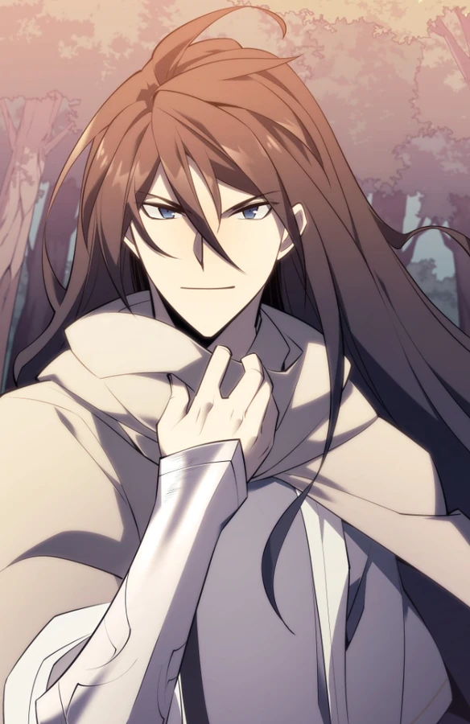 | 위키 인물 대표 컷 · [출처](https://overgeared.fandom.com/wiki/Kraugel) · GitHub 파일 보관
| 피아로 (A−) | 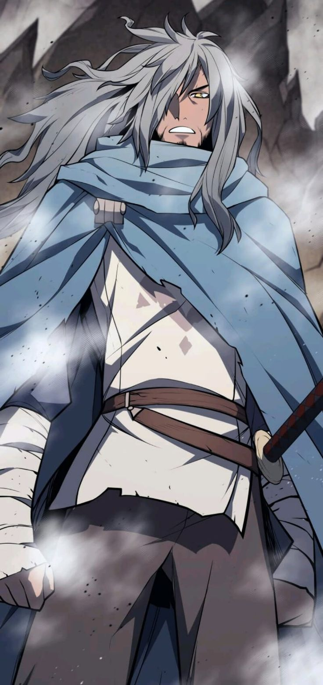 | 원작 컷 재게시 · [출처](https://br.pinterest.com/pin/818951513491309530/) · 미저장 |
| 메르세데스 (A) |  | 위키 인물 대표 컷 · [출처](https://overgeared.fandom.com/wiki/Mercedes) · GitHub 파일 보관
| 아그너스 (A−) | 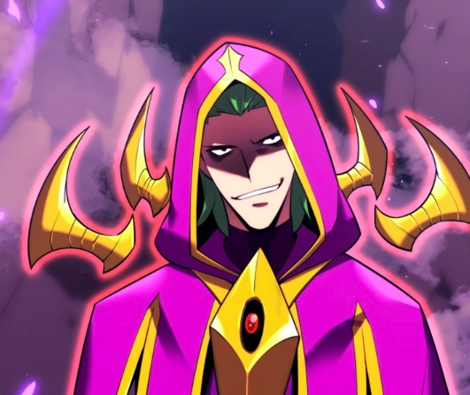 | 위키 인물 대표 컷 · [출처](https://overgeared.fandom.com/wiki/Agnus) · GitHub 파일 보관
| 지발 (B+) |  | 위키 인물 대표 컷 · [출처](https://overgeared.fandom.com/wiki/Zibal) · GitHub 파일 보관
| 마리로즈 (S) |  | 위키 인물 대표 컷 · [출처](https://overgeared.fandom.com/wiki/Marie_Rose) · GitHub 파일 보관
| 파그마 (A−) |  | 위키 인물 대표 컷 · [출처](https://overgeared.fandom.com/wiki/Pagma) · GitHub 파일 보관
| 하야테 (S) | 미확보 | [네이버](https://search.naver.com/search.naver?where=image&query=%ED%85%9C%EB%B9%A8%20%ED%95%98%EC%95%BC%ED%85%8C%20%EC%96%BC%EA%B5%B4%20%EC%9B%90%EC%9E%91%20%EC%BA%90%EB%A6%AD%ED%84%B0) · [구글](https://www.google.com/search?udm=2&q=%ED%85%9C%EB%B9%A8%20%ED%95%98%EC%95%BC%ED%85%8C%20%EC%9B%B9%ED%88%B0%20%EC%9B%90%EC%9E%91%20%EC%96%BC%EA%B5%B4%20%EB%8B%A8%EB%8F%85%20%EC%BA%90%EB%A6%AD%ED%84%B0) |

## 열렙전사

| 인물 / 티어 | 미리보기 | 확인 상태 · 자료 |
|---|---|---|
| 열렙전사 (A+) |  | 공식 원작 컷 · [출처](https://www.webtoons.com/en/action/hardcore-leveling-warrior/list?title_no=1221) · 미저장 |
| 다크 (A−) |  | 위키 인물별 대표 컷 · [출처](https://hardcorelevelingwarrior.fandom.com/wiki/Dark) · GitHub 파일 보관
| 소라 (B+) |  | 위키 인물별 대표 컷 · [출처](https://hardcorelevelingwarrior.fandom.com/wiki/Sora) · GitHub 파일 보관
| 제로 (S) |  | 위키 인물별 대표 컷 · [출처](https://hardcorelevelingwarrior.fandom.com/wiki/Zero) · GitHub 파일 보관
| 하트히터 (A−) | 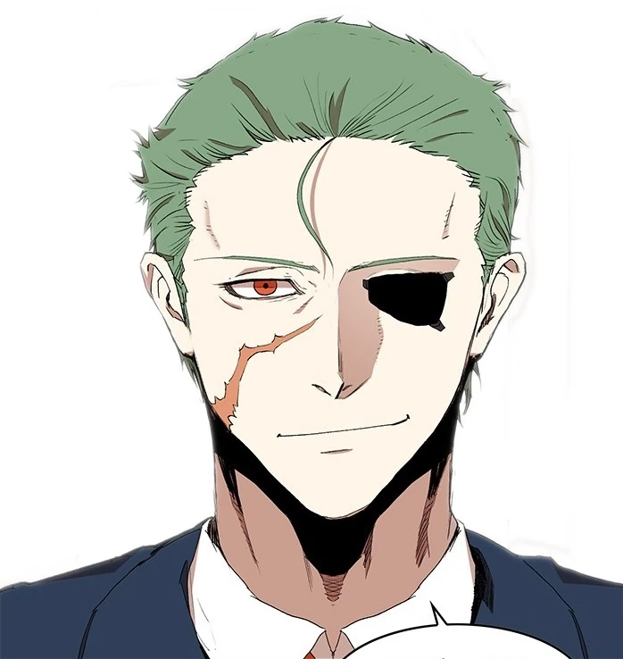 | 위키 인물별 대표 컷 · [출처](https://hardcorelevelingwarrior.fandom.com/wiki/Heart_Heater) · GitHub 파일 보관
| 요피 (B+) | 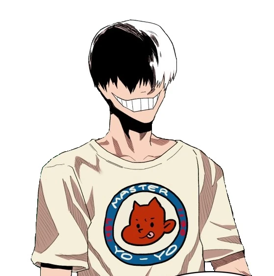 | 위키 인물별 대표 컷 · [출처](https://hardcorelevelingwarrior.fandom.com/wiki/Yopi) · GitHub 파일 보관
| 노네임 (A−) |  | 위키 인물별 대표 컷 · [출처](https://hardcorelevelingwarrior.fandom.com/wiki/No_Name) · GitHub 파일 보관
